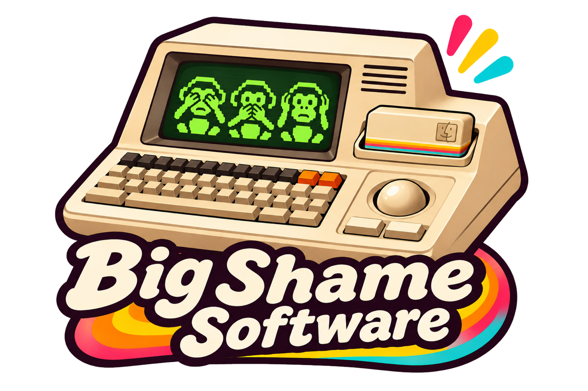
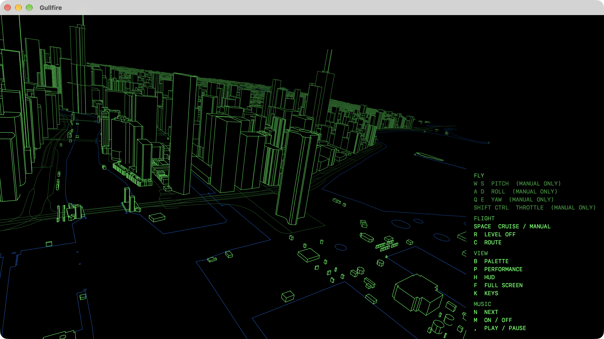
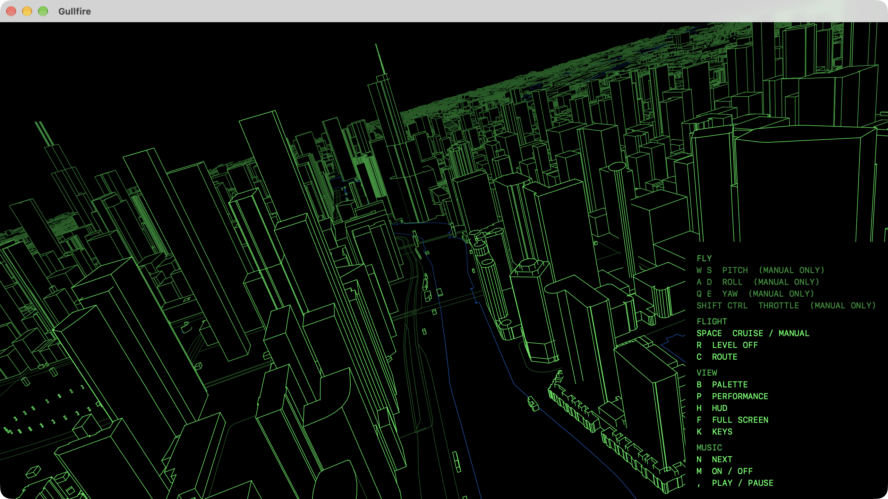
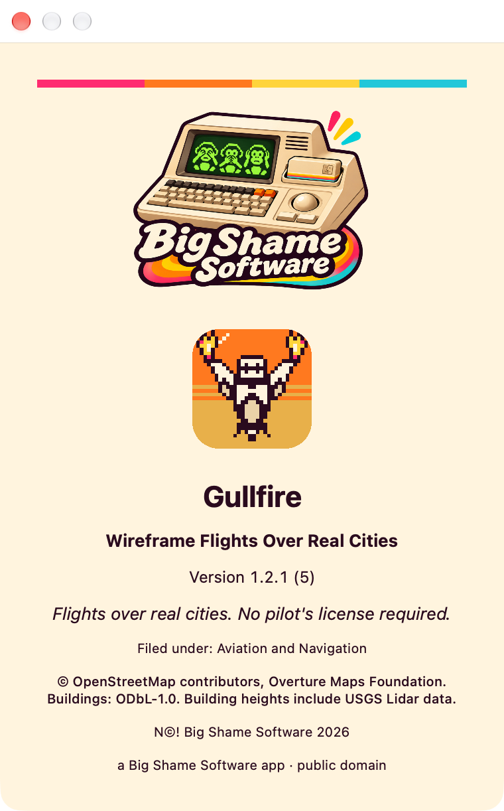
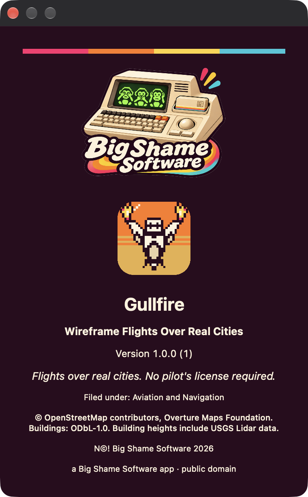
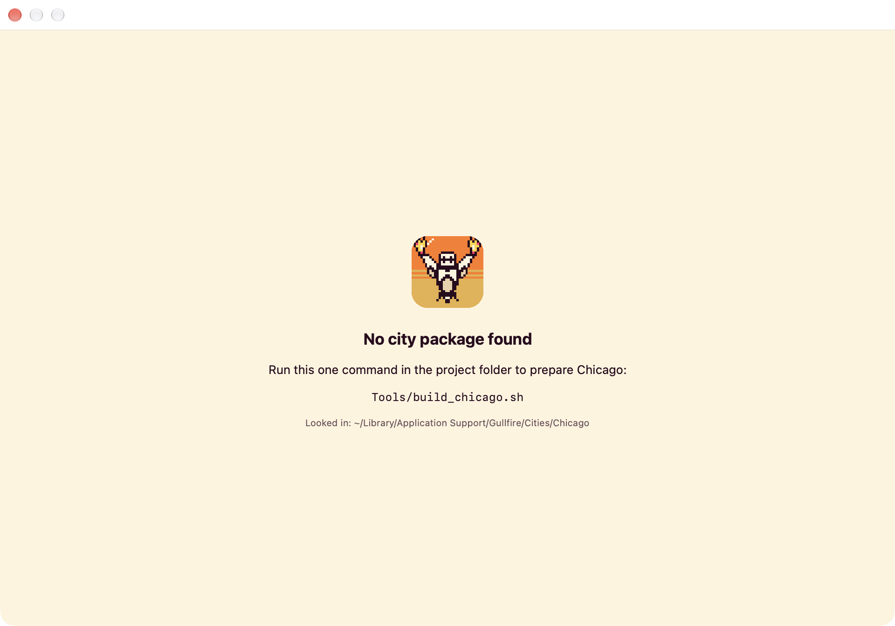
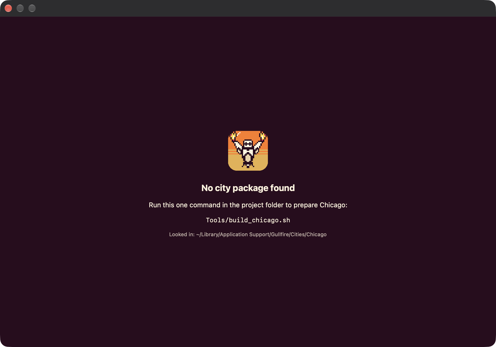
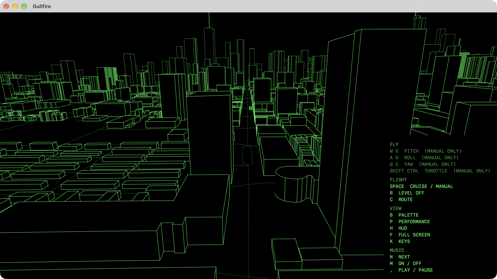

<p align="center"></p>

# Gullfire: Wireframe Flights Over Real Cities

<p></p>

*Filed under: Aviation and Navigation*

Gullfire is a native macOS app that flies a simulated aircraft over a real city, drawn as green hidden-line wireframes on black.

In 1981 a movie imagined what a navigation computer would show a pilot coming in over a city at night: green lines on black, every building a box. We liked it enough to build it with real map data. Gullfire 1.2.0 is source only: there is no download, so you build it yourself. It needs macOS 27 on Apple silicon, Xcode 27, XcodeGen and uv. It does not do anything useful. I'm serious. It flies over Chicago, very carefully.

<p align="center"></p>

## What it does

- Flies over a real city built from open map data, as green hidden-line wireframes on black.
- You fly it yourself, or the autopilot takes it round a cruise route: Scenic, or River, which follows the river's centreline.
- Six street routes, which fly low along the city's streets.
- Three colour schemes, a HUD and a performance overlay.
- Music: a piece by Erik Satie, your own music folder, a cathedral track, or a MIDI file you choose.
- Never uses the network while it runs.

<p align="center"></p>

## What it doesn't do yet

- Chicago is the only city in this release. You build its package yourself (see Getting a city).
- There is no map picker. Gullfire opens the one city it finds.
- The glider is not included. Add your own model file to show it (see Adding a glider).
- The game controller is supported, but it has not been tested on real hardware.
- The River route can drop to about 33 frames a second for a few seconds during a long full-screen flight. The cause is not known yet.
- In full-screen 5K runs, memory use moves between about 630 MB and 930 MB. The cause is not known yet.
- Something outside the app can briefly hide its window during a run. We have seen it, and have not found the cause.
- VoiceOver reads Settings and the route announced when you press C. It does not yet read the route hint at launch or the key list.
- Pressing U while low, at about 80 m over the tallest towers, can brush a roof once, with about 5 m clearance, before the aircraft climbs away.
- Downtown, where the towers rule out most joins, few or no streets can be picked, so pick mode can show nothing there.
- Picking a street, and endless flight with it, is an alpha feature. It works, and it will change. Expect streets that cannot be picked, and the odd rough join.
- The ride is not smooth everywhere yet. We smoothed street runs and endless flight in 1.2.0. They still have small vertical bumps at the tops of climbs and dips. The Scenic route has jolts where the lap closes, and the River route has bumps we have not explained. Flying by hand is unchanged.
- Nothing here has a date.

## Use

1. Build the app. See Build below. You should see the build finish with no errors.
2. Build Chicago's map with `Tools/build_chicago.sh`. See Getting a city below. You should see seven steps print in turn, with each one's time.
3. Open the app: `open DerivedData/Build/Products/Release/Gullfire.app`. You should see the flight over Chicago, starting on the Scenic route, with the key list at the bottom right.

Start the app and it flies the Scenic route on autopilot. The list of routes appears at the bottom of the window at launch, with the line PRESS C FOR THE NEXT ROUTE. Press C to change the route.

| Key | Action |
|---|---|
| W / S | Pitch down / up |
| A / D | Bank left / right |
| Q / E | Rudder left / right |
| Shift / Control | Throttle up / down |
| Space | Cruise or manual (manual to cruise blends over 3 seconds) |
| R | Level off |
| T / V | Height up / down |
| J | Mouse flight on or off |
| I | Pick a street to fly, then carry on as endless flight (alpha). I or Esc cancels |
| U | Endless flight on or off |
| C | Next route, and show the list of routes at the bottom of the window |
| B | Cycle the colour scheme (Default, Brand, Lime) |
| P | Show or hide the performance overlay |
| H | Cycle the readout: off, then the flight information, then the flight information with the performance and session lines |
| K | Show or hide the key list (shown bottom right at the start) |
| G | Show or hide the glider (listed only when a model file is installed; see Adding a glider) |
| F | Full screen |
| N | Next music track (not in cathedral mode) |
| M | Music on or off |
| , (comma) | Play or pause the music |

Every key also has a menu item in the Flight, Music and View menus. Music plays from a folder you choose in Settings (Gullfire > Settings), in a random order with a crossfade (5 seconds unless you change it), and starts when you press M: the app is silent at launch. It pauses while the window is hidden; a Settings switch turns that off. Settings also has a cathedral button (a building icon, no text). It looks for a track of about 3 minutes 33 seconds in your music folder and your Music library, and offers the one it finds with a fade slider. Playing it loops that one track with the fade, which starts at the longest the track allows. "Back to My Music Folder" returns to the shuffle. A connected game controller uses the left stick, triggers and shoulder buttons.

With no music folder or file set, M plays the demo piece, Erik Satie's *Gymnopédie No. 1*, endlessly. Settings also offers the piece endless or as a loop, or a MIDI file you choose. The sound is our own synthesized pad and reverb, with no samples and no recordings.

### Flight height and mouse flight

In cruise, T and V raise and lower the autopilot's flight height in 10 m steps, from 60 m below to 120 m above the route's own height. The HUD shows it as HEIGHT +30 M, or HEIGHT 0 M at the route's own height. Lowering is limited by what the aircraft can recover before the roofs and towers ahead. A street run never goes below its own height. Over open ground the full setting is allowed. The height resets to 0 when you change route with C.

When you fly by hand, T and V set a target altitude 10 m above or below the aircraft, or above or below the last target. The aircraft climbs or descends to it. Touching the pitch keys or the mouse drops the target. The HUD shows it as HEIGHT TARGET nnnn FT.

J turns mouse flight on and off. Moving the mouse right banks right, and moving it forward, away from you, puts the nose down. The scroll wheel changes throttle. The stick eases back to centre slowly when the mouse stops. Turning mouse flight on switches to manual flight by itself, so Space is not needed first. The pointer is hidden and held while it is on. Esc always gives it back, and so does switching to another window or app. The HUD says MOUSE ON / ESC TO RELEASE, or a small notice does when the HUD is off. Settings (View tab) has Mouse flight sensitivity and Invert pitch.

### Endless flight and picking a street

Picking a street is an alpha feature. It works, but expect gaps and rough edges: streets that cannot be picked, a join that is not tidy, and a ride that is not as smooth as we want (see What it doesn't do yet).

U starts endless flight. The aircraft flies loops made from the city's streets, one after another, with no input. It starts from cruise. If you are flying by hand, it switches to cruise first, then climbs over the roofs to join. The next loop is built in the background. The swap comes about a lap after you start it, when the aircraft reaches the end of the stretch it is on. The HUD shows `ENDLESS LOOP n / <street>` and `NEXT LOOP IN m:ss`. Press U again, or C, to stop. Space still switches between manual flight and cruise, and keeps endless flight on. In cruise the height keys do not change the climb-out that follows Space. Entering endless flight or a picked street is always a climb over the roofs first, then a join. For the first minute after it, the aircraft flies up to 60 m higher than the route and settles down.

Without a street graph in the city package, U says so and does nothing else. See Street graph below.

I lets you pick a street. The pointer is free. Move it over the flight view and the HUD names the street under it. Click to fly that street, then carry on as endless flight. Only streets that can start a loop are offered. The build marks them, and about half of Chicago's streets qualify, so none is offered where the towers rule out the joins. While pick mode is on, those streets are drawn as yellow lines over the city: thin for each one within about 4 km, thick for the one under the pointer, thickest for the one you picked. A click snaps to the nearest of them within 1.5 km. A click with none that near finds no street, and so does a click on the sky or the lake. If a street still cannot start a loop, the nearest one that can is flown and the HUD says which. Buildings in front hide them. The mode stays on after a click, so you can pick another street. I or Esc leaves it, and the lines go. Pick mode and mouse flight never run together.

### About and the credit line

**Gullfire > About Gullfire** opens the About window. It shows the version and the build number, and the map credit once a city is loaded. It follows the light or dark appearance of your Mac.

<p align="center"> </p>

### Getting a city

Run this one command from the project folder:

```bash
Tools/build_chicago.sh
```

It needs the network once, to download the map data, plus uv and Xcode 27. Later runs keep the download. It runs seven steps and prints each one with its time. It fetches the Overture and OpenStreetMap data and packs the city package. It writes the Scenic and River routes, then the street routes for seeds 1 to 6, then the street graph. Next it marks which of those streets can start a loop. The last step installs the package where Gullfire looks for it.

On one Mac (Apple silicon, macOS 27, Overture release 2026-10-21.0), the first run from an empty `Cities` folder took about 50 seconds. The fetch step, which includes the download, took 17 seconds of that; packing took 14 seconds; the street routes took 17 seconds. Later runs, with the data already downloaded, took about 20 seconds. The package is about 41 MB. The `raw` folder beside it holds the downloaded input, 56 MB. The app does not need it, and the install leaves it out, but the street-route tool reads it, so keep it in `Cities/Chicago` if you want more routes.

**Install.** The last step copies the package to `~/Library/Application Support/Gullfire/Cities/Chicago`, which is where Gullfire looks when you open it from the Dock or Finder. It prints the folder it wrote to. The install is safe to repeat: it replaces only a folder that an earlier run of the script created. It never writes through a symbolic link. If the folder already exists and the script did not create it, the script stops and changes nothing. Options:

- `--dest DIR` (or the `GULLFIRE_INSTALL_DIR` variable) installs into another folder instead.
- `--no-install` builds only, and leaves the package in `Cities/Chicago`.
- `--force` replaces an existing folder that the script did not create. The old folder is moved aside, named `...before-build-<time>`, and not deleted. It never replaces a symbolic link.

Gullfire also finds a package in the folder named by `GULLFIRE_CITY`, or in `Cities/Chicago` inside the project folder when you run it from there.

<p align="center"> </p>

### Street routes

The script writes six street routes, `street-1` to `street-6`: low flights along the city's straight streets, each a loop, the same every time for its seed. Each route climbs over the roofs between streets and flies each street at 15 m, and the tool checks every route before it writes it, so a route that fails the check is not written. To make more, run the route maker with other seeds (`--help` lists the settings):

```bash
uv run --with numpy --with shapely Tools/make_street_routes.py Cities/Chicago --seeds 7 8
```

<p align="center"></p>

### Street graph

A city package can carry an optional file, `streets.json`. It lists the open straight street stretches already checked clear at 15 m, with their names and class. Endless flight and picking a street need it. `Tools/build_chicago.sh` writes it with the other package files. A package without it flies exactly as before. The app never reads the raw map files.

`Tools/make_street_graph.py` writes the file. Run it on the city folder, the one that holds the package and its `raw` folder:

```bash
uv run --offline --with numpy --with shapely python -I Tools/make_street_graph.py <city folder>
```

The script reads the `raw` folder, so keep it in place, as the street routes do.

### Adding a glider

G shows or hides a wireframe aircraft that you fly behind, from a close chase view. Gullfire does not include one of its own. Without a model file, G does not appear in the key list, and the View menu has no glider item. To add an aircraft, put a model file where Gullfire looks for it.

**Where the file goes.** `~/Library/Application Support/Gullfire/Models/gullfire.json`. To use another file, set `GULLFIRE_MODEL` to its path before you start Gullfire.

**The format.** The file is JSON, with five fields:

| Field | Meaning |
|---|---|
| `name` | Text, written to the run log when the model loads. |
| `spanM` | Wingspan, in metres. |
| `lengthM` | Length, in metres. |
| `triangles` | Nine numbers per triangle: the x, y and z of each of its three corners. Triangles are not drawn. They only hide the lines behind them. |
| `lines` | Six numbers per line: the x, y and z of each end. These are the lines you see. |

The axes are: x forward, y up, z to the right. The origin is the wing root. All distances are in metres.

**Size.** The street routes leave about 6 m either side of each street's centre line, about 12 m in all. An aircraft with a wider span still flies, but its wingtips can pass through the buildings on the street routes. The example's 10 m fits.

**Try the example.** The repository has `Examples/example-glider.json`, a generic sailplane made for this purpose. To try it, copy it to the place above, then start Gullfire and press G:

```bash
mkdir -p ~/Library/Application\ Support/Gullfire/Models
cp -n Examples/example-glider.json ~/Library/Application\ Support/Gullfire/Models/gullfire.json
```

`cp -n` will not replace a model that is already there.

To remove it, delete the file. G leaves the key list the next time Gullfire starts.

**If the file is wrong.** A file that is missing, cannot be read, or is not a valid model is ignored. Gullfire starts as normal with no aircraft, and G is not shown. Gullfire does not change or write the file.

## Requirements

- macOS 27 or later, on Apple silicon
- Xcode 27
- [XcodeGen](https://github.com/yonaskolb/XcodeGen)
- [uv](https://docs.astral.sh/uv/), to fetch the map data

## Build

```bash
xcodegen generate
xcodebuild -project Gullfire.xcodeproj -scheme Gullfire -configuration Release -derivedDataPath DerivedData build
```

The app is then at `DerivedData/Build/Products/Release/Gullfire.app`. Open it with Finder, or run `open DerivedData/Build/Products/Release/Gullfire.app` from the project folder.

No prebuilt binaries are published.

## Versioning

Gullfire uses [Semantic Versioning](https://semver.org/spec/v2.0.0.html). Changes are listed in [CHANGELOG.md](CHANGELOG.md).

The public interface, which the version numbers promise to keep, is:

- the city package format (`manifest.json` with `"formatVersion": 1`, and the binary files beside it);
- the route file format (`routes/*.json`);
- the arguments of `Tools/fetch_city.py`, `gullfire-pack` and `gullfire-render`;
- the minimum system, macOS 27 on Apple silicon;
- the documented behaviour that the app never uses the network.

## Privacy

Gullfire collects and sends nothing. See [PRIVACY.md](PRIVACY.md).

## How to help

If you have a game controller, telling us whether it works would help more than anything else. Please open an issue with the controller's name and what happened. We don't take pull requests, so an issue is the way in. We'd rather know.

If a flight does something odd, an issue with the city, the route and what you saw is the most useful report.

## Credits and thanks

- Map data comes from OpenStreetMap and Overture Maps: © OpenStreetMap contributors, Overture Maps Foundation. The data is under the Open Database Licence (ODbL) 1.0, through OpenStreetMap, Microsoft ML Buildings and TomTom as Overture supplies them. Building heights include USGS Lidar data; the [USGS 3D Elevation Program page](https://www.usgs.gov/3d-elevation-program) says its products are free of charge and without use restrictions, and does not call the data public domain. A map you build is a copy of that data, so anyone who shares it must keep this credit and the ODbL terms. The map data is not in this repository, and this repository does not license it. The build writes the credit line into the city package, and the About window shows it.
- Inspired by the wireframe navigation-computer sequence in *Escape from New York* (1981).
- This app was written mostly with Claude, with some consulting from ChatGPT and occasional help from Gemini or an on-device Qwen model. No Grok was used.
- Erik Satie's *Gymnopédie No. 1* is a MIDI file from the [Mutopia Project](https://www.mutopiaproject.org/cgibin/piece-info.cgi?id=37). The Mutopia page says "Copyright: Public Domain" and "CC: No rights reserved".

## Licence

N©! Big Shame Software 2026. Public domain, via [the Unlicense](LICENSE).

a Big Shame Software app
